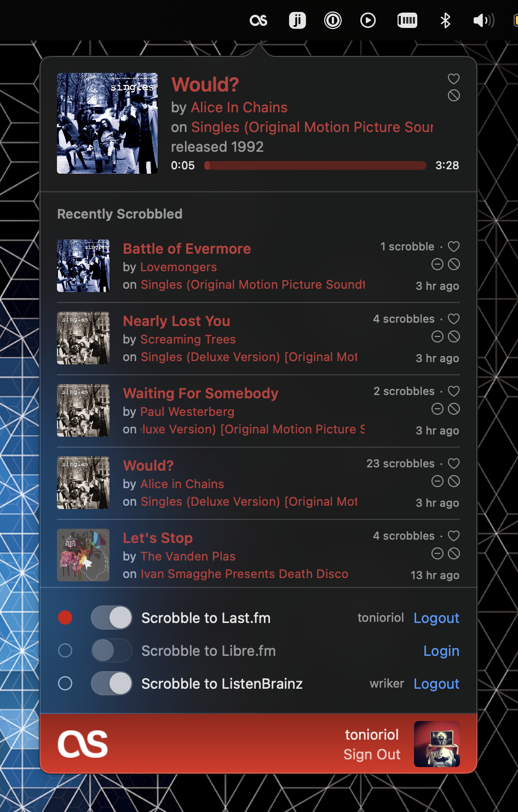

# Scroblebler for Apple Music


Scroblebler is a native macOS application that scrobbles tracks from any media player — Apple Music, Spotify, browsers, and more — using the system MediaRemote framework.

## Features

- **Universal Source Support**: Scrobbles from any media player via MediaRemote (Apple Music, Spotify, browsers, etc.)
- **Smart Music Detection**: Automatically filters out non-music content (YouTube videos, podcasts, tech talks) using the ListenBrainz MBID Mapper with a fallback chain (trusted players → cache → API → local DB → album heuristic → fail-closed)
- **Multiple Scrobbling Services**: Support for Last.fm, ListenBrainz, and Libre.fm
- **Unidirectional Sync**: Sync your listening history from a primary service to secondary services
- **Periodic Background Sync**: Automatically retries pending/failed operations every 60 seconds
- **Service-Specific Branding**: Visual indicators for each scrobbling service with logos and colors
- **Track Loving**: Love/unlove tracks directly from the app
- **Blacklist Management**: Blacklist tracks to prevent unwanted scrobbles
- **Undo Support**: Undo recent scrobbles with reliable web-based Last.fm deletion
- **Play Count Display**: View play counts for your tracks
- **Listening History**: Browse your full scrobble history with infinite scroll, offset-based pagination, and background backfill
- **Profile View**: View your scrobbling profile with avatar and statistics
- **Album Artwork**: Display album artwork with disk-persistent caching and Last.fm fallback
- **Now Playing**: Real-time now playing updates
- **Launch at Startup**: Automatically start scrobbling when you log in
- **Offline Queue**: Scrobbles are queued when offline and synced when connectivity returns
- **Fast Startup**: UI renders instantly — network calls happen in the background

## Screenshot



## Requirements

macOS 11 Big Sur or later, on Apple silicon or Intel Macs.

## Installing

### Homebrew (Recommended)

```bash
brew install --cask tonioriol/scroblebler/scroblebler
```

### Manual

Download the latest zip from [Releases](https://github.com/tonioriol/scroblebler/releases/latest), unzip it and move Scroblebler to Applications. Releases are signed with Developer ID and notarized, and the app updates itself with Sparkle.

## Building

Scroblebler is a Swift package; the Makefile assembles, signs and checks the app bundle. No Xcode project is needed.

### Prerequisites

- Xcode 16.4 to build for macOS 11. Xcode 26 and later can't target macOS 11, so copy `Local.mk.example` to `Local.mk` (git-ignored) to build for macOS 12 and later instead.
- A "Developer ID Application" certificate for team B65K228Z97 in the keychain. Without it the app is signed ad hoc, and macOS asks for keychain access again after every build.

### Commands

```bash
make test                          # Run the test suite
make app                           # Debug build in build/Scroblebler.app
make app verify CONFIGURATION=release  # Universal release build, then check signature, architectures and minimum macOS
make release-zip CONFIGURATION=release # Release build zipped for distribution
make reinstall                     # Replace /Applications/Scroblebler.app with a fresh build and launch it
```

Logs:

```bash
log stream --predicate 'subsystem == "com.tonioriol.scroblebler"' --info --debug
```

## Releasing

Every push to `main` with user-facing [Conventional Commits](https://www.conventionalcommits.org) (`feat`, `fix`, `perf` or a breaking change) since the last tag releases the next version automatically (`.github/workflows/release.yml`):

1. [Cocogitto](https://docs.cocogitto.io) bumps the version, updates `CHANGELOG.md` and tags it.
2. The app is built with Xcode 16.4 as a universal binary, tested, signed with Developer ID, checked with `make verify`, notarized and stapled.
3. The zip is signed for Sparkle, attached to a GitHub release, and added to the appcast on the `gh-pages` branch with HTML release notes.
4. The Homebrew cask in `scroblebler.rb` and [tonioriol/homebrew-scroblebler](https://github.com/tonioriol/homebrew-scroblebler) is updated.

Other branches and pull requests are tested and built the same way by `.github/workflows/build.yml`.

## Credits

Scroblebler is maintained by [Toni Oriol](https://github.com/tonioriol). It started as a fork of [Audioscrobbler](https://github.com/heyvito/audioscrobbler), created by [Victor Gama](https://github.com/heyvito).

Media playback control and detection uses [mediaremote-adapter](https://github.com/ejbills/mediaremote-adapter) by ejbills (forked from ungive's original work), which provides a Swift interface to macOS's private MediaRemote framework.

## Oh no, you pushed your token and secret!

Yep. I know! There's not much one can do with the API, and even Last.fm's tokens are [available
on their repository](https://github.com/lastfm/lastfm-desktop/blob/9ae84cf4ab204a92e6953abe14026df70c140519/lib/unicorn/UnicornCoreApplication.cpp#L58)

## Known Issues

- Music.app may restart immediately after quiting. I intend to fix this in the near future.

## TODO

- [x] Sign, Notarize & Provide DMG installer.
- [x] Start at Login.
- [x] Extract and unify the exponential backoff logic.
- [x] Add playcontrols.
- [x] Use proper logger.
- [x] Testing.
- [x] Links in now playing for lastfm not working.
- [x] Display full date on hover.
- [x] Detect non music playback (from browser, podcasts, videos, system sounds) — MusicValidator with MBID Mapper.
- [x] Filter out YouTube / non-music browser content — MusicValidator fail-closed for untrusted sources.
- [x] Local-first storage + sync engine (store scrobbles locally, offline queue, background sync to multiple services). This should fix ListenBrainz cache losing scrobbles, enable retry for unsynced scrobbles, make undo/sync state consistent, and allow caching history locally.
- [x] Taking 10+ seconds to load.
- [x] Stop the constant reloading of images on scroll in history view.
- [ ] Fix progress bar jumping UI, animation of bar screwing up when opening/closing app.
- [x] Stop requesting images and stuff every time we click in the progress bar.
- [ ] Fix UI for password request for Last.fm.
- [ ] Display blacklisted tracks somewhere, otherwise we have no way of knowing which tracks were blacklisted.
- [x] Auto-update.
- [ ] Add macOS notification center alerts (for track change, for API failures...).
- [ ] Show multiple playing sources in player.
- [ ] Edit track info before/after scrobbling.
- [ ] Add metrics (with opt-out).
- [ ] Edit scrobbles (for fixing wrong metadata, or adding missing info). Maybe keep the rule (search/replace or something like that) and allow for future automatic uses and backward fixing.
- [ ] History fixer for false positives (YouTube videos scrobbled as music) with confidence threshold and user confirmation.
- [ ] Factory methods on the model violate Single Responsibility Principle. Track should be a pure data model, and conversion logic belongs in the clients/decoders.
- [ ] Update the reverse domain.
- [ ] Fix credits/dates in files.

## License

This project is licensed under the MIT License - see the [LICENSE](LICENSE) file for details.
